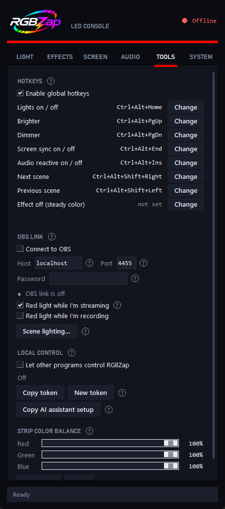

<p align="center">
  
</p>

<p align="center"><b>A free Windows desktop app for cheap Bluetooth LED strips.</b><br>
Colors, effects, screen sync, music, hotkeys, On-Air light, OBS, notification alerts — no
phone, no hub, no account.</p>

---

RGBZap controls **ELK-BLEDOM-style Bluetooth LED strips** — the ones sold with phone apps
like *duoCo Strip* / *Lotus Lantern* and a little IR remote — straight from your PC over
Bluetooth LE.

<p align="center">
  
  
</p>

## Features

- **Light** — color picker, presets, your own saved colors, brightness, and **scenes**
  (save a color + brightness + effect under a name, apply it in one click).
- **Effects** — every effect as a live preview tile, so you see what it does before you
  pick it. **Ambient** drifts (Aurora, Lava lamp, Vaporwave, Sunset, Forest, Galaxy, Ice,
  Rainbow, Ocean); **flames & pulses** (Candle, Torch, Fire, Breathe, a
  4-7-8 breathing guide, Heartbeat, Neon flicker, Lightning, Fireworks, Police, Party);
  plus the strip's own built-in jump / crossfade / blink modes.
- **Screen Sync (Ambilight)** — the strip follows a monitor's color in real time. Picks
  the *dominant* color so scenes pop instead of averaging to mud, and keeps a dim glow on
  dark scenes. Great for movies and games. **Ignores black bars** on widescreen films, and
  can sample **just the edges** (bias lighting) or one side of the screen.
- **Audio reactive** — pulse, beat flash, beat colors, spectrum, or pitch, from whatever
  your PC is playing.
- **Global hotkeys** — turn the lights on/off, dim or brighten, switch scenes, and start or
  stop screen sync from anywhere, even in a full-screen game. Every shortcut is yours to
  change.
- **On-Air light** — the strip turns red while your webcam (optionally your microphone) is
  on, so the people around you know you're live. Switch it from the tray.
- **OBS link** — red while you stream or record, and a different look for each OBS scene.
  Uses OBS's built-in WebSocket server (OBS 28+), no plugin.
- **Command line & local API** — `rgbzap color red`, `rgbzap scene "Movie night"`. Drive
  the lights from Stream Deck, AutoHotkey, scripts, or a build-status light. See below.
- **Notification & call alerts** — a quick flash when a notification arrives, a green
  pulse while a call rings (Phone Link, Teams, WhatsApp, Discord…), then the strip goes
  back to exactly what it was doing.
- **Comfort** — colors **fade** into each other instead of snapping, and **Reduce
  flashing** softens fast effects, alerts and screen-sync cuts for anyone sensitive to
  flashing lights. A **color balance** control fixes strips whose "white" looks pink or blue.
- **Lights off with your PC** — switches the strip off when you shut down, restart or sign
  out (and brings it back if Windows cancels the shutdown). On by default; untick it in
  **System** if you'd rather the strip stay as it is.
- **Multiple strips** — scan, pick yours from a list, and RGBZap remembers it. Connects
  automatically on launch and reconnects by itself if the link drops. Strip not listed?
  Tick **Show all Bluetooth devices** and pick it from there.
- **Update notices** — a banner tells you when a new version is out (optional, see Privacy).
- **Lives in the tray** — close the window and it keeps running; right-click the tray icon
  for colors, scenes, effects, and the On-Air light. Optional start with Windows.

<p align="center">
  
  
  
  
</p>

## Install

### Download (no Python needed)
From the latest [Release](../../releases), grab either:

- **`RGBZap-Setup-<version>.exe`** — the installer. No admin rights needed; adds a Start
  menu entry, an optional desktop shortcut, optional start-with-Windows, and a normal
  uninstaller (Settings › Apps).
- **`RGBZap-<version>-windows.zip`** — portable. Unzip anywhere and run **`RGBZap.exe`**.

> **"Windows protected your PC"?** RGBZap is new and not code-signed yet, so SmartScreen
> doesn't recognize it. Click **More info → Run anyway**. The full source is right here if
> you'd rather check it — or run it from source below.

### Run from source
```
pip install -r requirements.txt
python elk_gui.py
```
Python 3.10+ on Windows. `Launch RGBZap.bat` opens it without a console window.

`elk_control.py` is a separate, direct-to-the-strip tool (it can't run while RGBZap is
connected — a strip takes one connection at a time):
```
python elk_control.py scan
python elk_control.py color 255 0 0
python elk_control.py on
```
To control a *running* RGBZap, use `rgbzap` / `python rgbzap_cli.py` (see below).

## First run
1. Power on the strip.
2. **Close the phone app** (and don't pair the strip in Windows Bluetooth settings) — a
   strip accepts only **one** Bluetooth connection at a time, so anything else holding it
   hides it from the scan.
3. Open RGBZap. It finds your strip, connects, and remembers it. Got more than one? Tap
   **↻** on the Light tab and pick from the list.

## Hotkeys
Open the **Tools** tab. These work from anywhere once RGBZap is running; press **Change**
beside one to pick your own.

| Action | Default |
|---|---|
| Lights on / off | `Ctrl+Alt+Home` |
| Brighter / Dimmer | `Ctrl+Alt+PgUp` / `Ctrl+Alt+PgDn` |
| Screen sync on / off | `Ctrl+Alt+End` |
| Audio reactive on / off | `Ctrl+Alt+Ins` |
| Next / previous scene | `Ctrl+Alt+Shift+→` / `Ctrl+Alt+Shift+←` |

If a shortcut doesn't work, another program already owns it — RGBZap tells you, and you
can pick a different one. Shortcuts need Ctrl, Alt or Win, so ordinary typing is never
touched.

## On-Air light and OBS
**On-Air light** (Tools tab, or the tray menu): the strip goes red while your webcam is in
use — tick *microphone* too if you want. When it ends, the strip returns to what it was
showing. RGBZap only asks Windows *whether* the camera or mic is on; it never uses either.

**OBS link**: in OBS turn on *Tools › WebSocket Server Settings › Enable WebSocket server*,
then tick **Connect to OBS** in RGBZap's Tools tab and enter the port and password. You
can have the strip go red while you stream or record, and pick a RGBZap scene for each OBS
scene with **Scene lighting…**. RGBZap only listens; it can't change anything in OBS.

## Command line and local API
Tick **Let other programs control RGBZap** in the Tools tab (it's off by default), then:

```
rgbzap status
rgbzap on                      rgbzap off
rgbzap color red               rgbzap color "#ff8800"      rgbzap color 255 136 0
rgbzap brightness 40
rgbzap scene "Movie night"     rgbzap scenes
rgbzap effect Aurora           rgbzap effect off           rgbzap effects
rgbzap sync on|off|toggle      rgbzap audio on|off|toggle
rgbzap flash green             # a short alert flash, then back to what it was
```

`rgbzap.exe` is installed in the `cli` folder inside RGBZap's folder; tick *Add the rgbzap
command to PATH* in the installer to use it from any terminal. It reads the port and secret token from RGBZap's
settings, so there's nothing to set up. Exit code 0 means it worked.

The same thing is a small HTTP API for other tools: `http://127.0.0.1:49732`, with the
token as `Authorization: Bearer <token>` (Tools tab › *Copy token*), JSON bodies like
`{"color": "red"}`. It only listens on your own PC, needs the token, refuses requests that
come from web pages, and can only do what RGBZap's own buttons can.

## Updating
Versions from 1.0.1 on show a banner when a new release is out. Click it, download the new
`RGBZap-Setup-<version>.exe` and run it — it upgrades in place and keeps your settings.
(1.0.0 has no update check, so install 1.0.1 or newer by hand once.)

## Requirements
- Windows 10 or 11
- Bluetooth LE (built in on most laptops; a cheap USB BLE dongle works on desktops)

## Supported strips
Works with the common **classic ELK-BLEDOM protocol** (9-byte `0x7e…0xef` frames):
ELK-BLEDOM, ELK-BULB, MELK, XSL-, "LED LIGHT STRIP", and similar. RGBZap
**auto-detects the write characteristic** (fff3 / ffe1 / Nordic-UART) on connect, so it
adapts to more variants than a hardcoded one.

Honest caveat: it's only verified on a real ELK-BLEDOM. A few models (e.g. some LEDBLE
variants) use a different byte order — the app connects but colors may look off. If your
strip connects but misbehaves, open an issue with its advertised name.

## Privacy
Everything stays on your PC. RGBZap has no account and no telemetry. The only internet
request it makes is an **update check**: about once a day it asks GitHub whether a newer
release exists, sending just a standard web request (the app name and version). It never
downloads or installs anything by itself — if there's a new version you get a banner and
download it yourself. Turn it off any time in **System › Updates**. Notification alerts
are **off by default**; when you turn them on, RGBZap
reads new notifications on your PC only to tell whether one arrived or a call is ringing —
nothing is stored or sent anywhere. The **On-Air light** only reads the on/off state Windows
keeps for the camera and microphone. The **local API** is off by default, only listens on
this PC and needs a secret token. The **OBS link** talks only to an OBS on the host you
enter (normally this PC). Global hotkeys register only the exact shortcuts you see in the
Tools tab; RGBZap never sees other keys you press.

Your settings and remembered strip live in `%APPDATA%\RGBZap` — delete that folder to
reset RGBZap. That includes the local API token and, if you use the OBS link, your OBS
password, so treat that folder as private.

## Notes
- **DRM video** (Netflix, Disney+, etc.) captures as **black** on Windows, so Screen Sync
  can't read it and fades to a dim glow. Local players, browsers, and YouTube work.
- Call detection reads the notification's wording ("Incoming call", "is calling", …), so
  it currently works for English-language notifications.
- **Reduce flashing** switches off the strip's own *Blink* and *Jump* effects, because they
  run inside the strip where RGBZap can't soften them.
- The On-Air light ignores RGBZap's own audio capture, so using Audio reactive never lights
  it. Voice-chat apps use the microphone constantly, which is why the microphone option is
  off by default.

## Build it yourself
```
py -m pip install -r requirements-dev.txt
build.bat
```
Produces in `dist\`: the `RGBZap\` app folder, a portable `RGBZap-<version>-windows.zip`,
and — if [Inno Setup 6](https://jrsoftware.org/isinfo.php) is installed
(`winget install JRSoftware.InnoSetup`) — the `RGBZap-Setup-<version>.exe` installer.
The version comes from `APP_VERSION` in `elk_gui.py`.

## Credits
The strip protocol comes from the excellent
[dave-code-ruiz/elkbledom](https://github.com/dave-code-ruiz/elkbledom) Home Assistant
integration (MIT) — see [THIRD_PARTY_NOTICES.md](THIRD_PARTY_NOTICES.md). RGBZap is a
standalone desktop app built on the same frames.

Made by [Dilshan Rangaka](https://dilshan-rangaka.vercel.app/). RGBZap is MIT licensed —
see [LICENSE](LICENSE).
