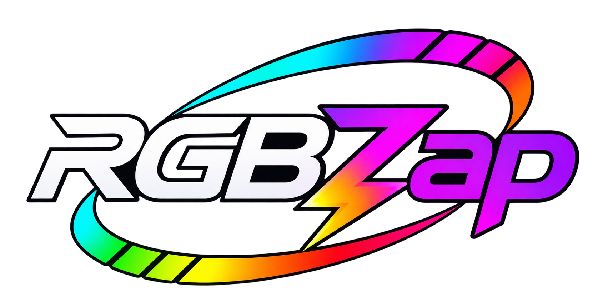
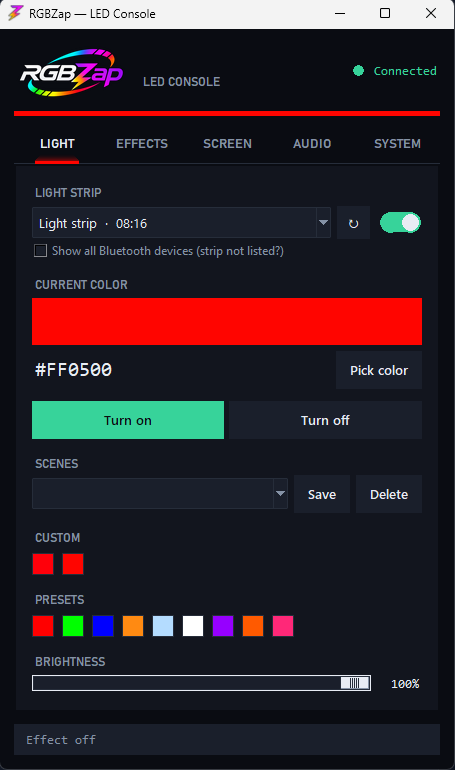
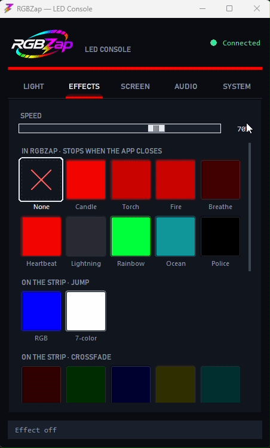
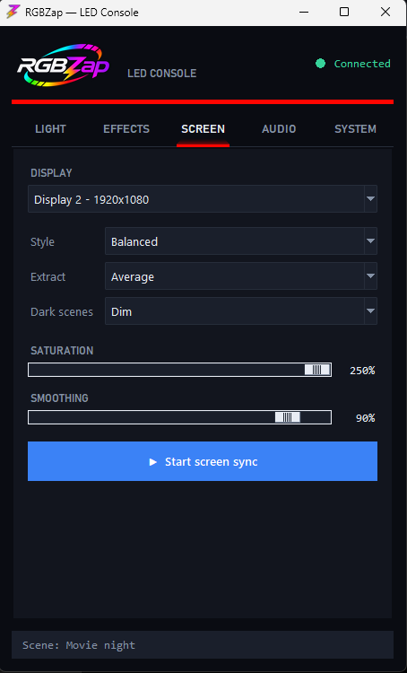
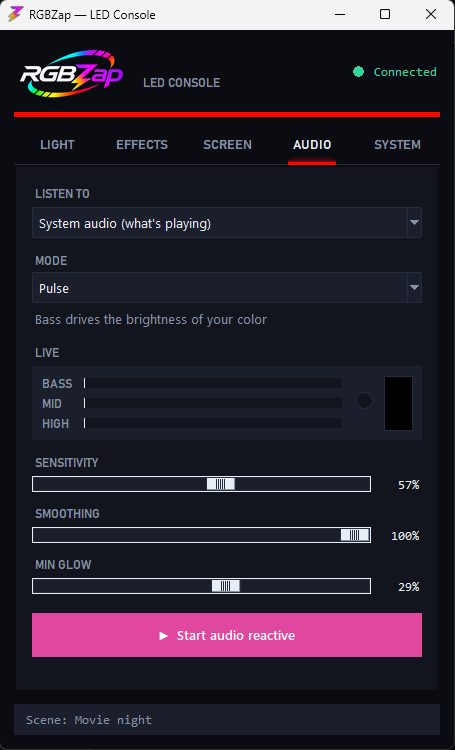
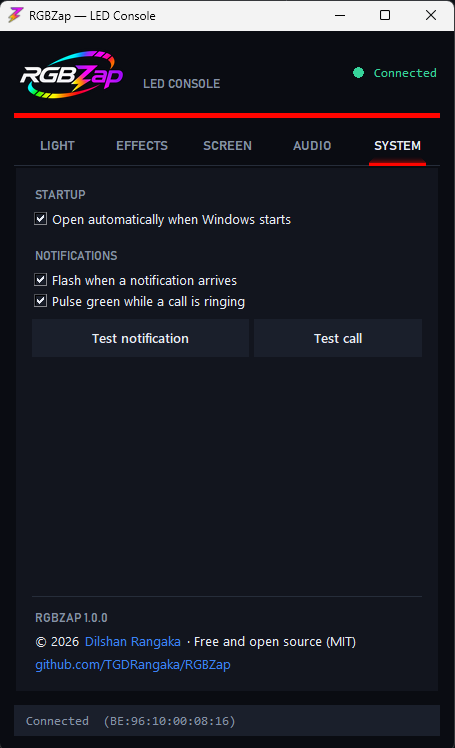

<p align="center">
  
</p>

<p align="center"><b>A free Windows desktop app for cheap Bluetooth LED strips.</b><br>
Colors, effects, screen sync, music, and notification alerts — no phone, no hub, no account.</p>

---

RGBZap controls **ELK-BLEDOM-style Bluetooth LED strips** — the ones sold with phone apps
like *duoCo Strip* / *Lotus Lantern* and a little IR remote — straight from your PC over
Bluetooth LE.

<p align="center">
  
  
</p>

## Features

- **Light** — color picker, presets, your own saved colors, brightness, and **scenes**
  (save a color + brightness + effect under a name, apply it in one click).
- **Effects** — every effect as a live preview tile, so you see what it does before you
  pick it. Smooth flame, breathe, heartbeat, lightning, rainbow, ocean, police, plus the
  strip's own built-in jump / crossfade / blink modes.
- **Screen Sync (Ambilight)** — the strip follows a monitor's color in real time. Picks
  the *dominant* color so scenes pop instead of averaging to mud, and keeps a dim glow on
  dark scenes. Great for movies and games.
- **Audio reactive** — pulse, beat flash, beat colors, spectrum, or pitch, from whatever
  your PC is playing.
- **Notification & call alerts** — a quick flash when a notification arrives, a green
  pulse while a call rings (Phone Link, Teams, WhatsApp, Discord…), then the strip goes
  back to exactly what it was doing.
- **Multiple strips** — scan, pick yours from a list, and RGBZap remembers it. Connects
  automatically on launch and reconnects by itself if the link drops.
- **Lives in the tray** — close the window and it keeps running; right-click the tray icon
  for colors, scenes, and effects. Optional start with Windows.

<p align="center">
  
  
  
</p>

## Install

### Download (no Python needed)
Grab the latest `RGBZap-windows.zip` from [Releases](../../releases), unzip anywhere, and
run **`RGBZap.exe`**.

> **"Windows protected your PC"?** RGBZap is new and not code-signed yet, so SmartScreen
> doesn't recognize it. Click **More info → Run anyway**. The full source is right here if
> you'd rather check it — or run it from source below.

### Run from source
```
pip install -r requirements.txt
python elk_gui.py
```
Python 3.10+ on Windows. `Launch RGBZap.bat` opens it without a console window.

There's also a small command-line tool:
```
python elk_control.py scan
python elk_control.py color 255 0 0
python elk_control.py on
```

## First run
1. Power on the strip.
2. **Close the phone app** (and don't pair the strip in Windows Bluetooth settings) — a
   strip accepts only **one** Bluetooth connection at a time, so anything else holding it
   hides it from the scan.
3. Open RGBZap. It finds your strip, connects, and remembers it. Got more than one? Tap
   **↻** on the Light tab and pick from the list.

## Requirements
- Windows 10 or 11
- Bluetooth LE (built in on most laptops; a cheap USB BLE dongle works on desktops)

## Supported strips
Works with the common **classic ELK-BLEDOM protocol** (9-byte `0x7e…0xef` frames):
ELK-BLEDOM, ELK-BULB, MELK, XSL-, "LED LIGHT STRIP", and similar. RGBZap
**auto-detects the write characteristic** (fff3 / ffe1 / Nordic-UART) on connect, so it
adapts to more variants than a hardcoded one.

Honest caveat: it's only verified on a real ELK-BLEDOM. A few models (e.g. some LEDBLE
variants) use a different byte order — the app connects but colors may look off. If your
strip connects but misbehaves, open an issue with its advertised name.

## Privacy
Everything stays on your PC. RGBZap has no account, no telemetry, and makes no internet
connections. Notification alerts are **off by default**; when you turn them on, RGBZap
reads new notifications on your PC only to tell whether one arrived or a call is ringing —
nothing is stored or sent anywhere.

## Notes
- **DRM video** (Netflix, Disney+, etc.) captures as **black** on Windows, so Screen Sync
  can't read it and fades to a dim glow. Local players, browsers, and YouTube work.
- Call detection reads the notification's wording ("Incoming call", "is calling", …), so
  it currently works for English-language notifications.

## Build it yourself
```
py -m pip install -r requirements-dev.txt
build.bat
```
Produces `dist\RGBZap\RGBZap.exe`. Zip the `dist\RGBZap` folder to share it.

## Credits
The strip protocol comes from the excellent
[dave-code-ruiz/elkbledom](https://github.com/dave-code-ruiz/elkbledom) Home Assistant
integration (MIT) — see [THIRD_PARTY_NOTICES.md](THIRD_PARTY_NOTICES.md). RGBZap is a
standalone desktop app built on the same frames.

Made by [Dilshan Rangaka](https://dilshan-rangaka.vercel.app/). RGBZap is MIT licensed —
see [LICENSE](LICENSE).
